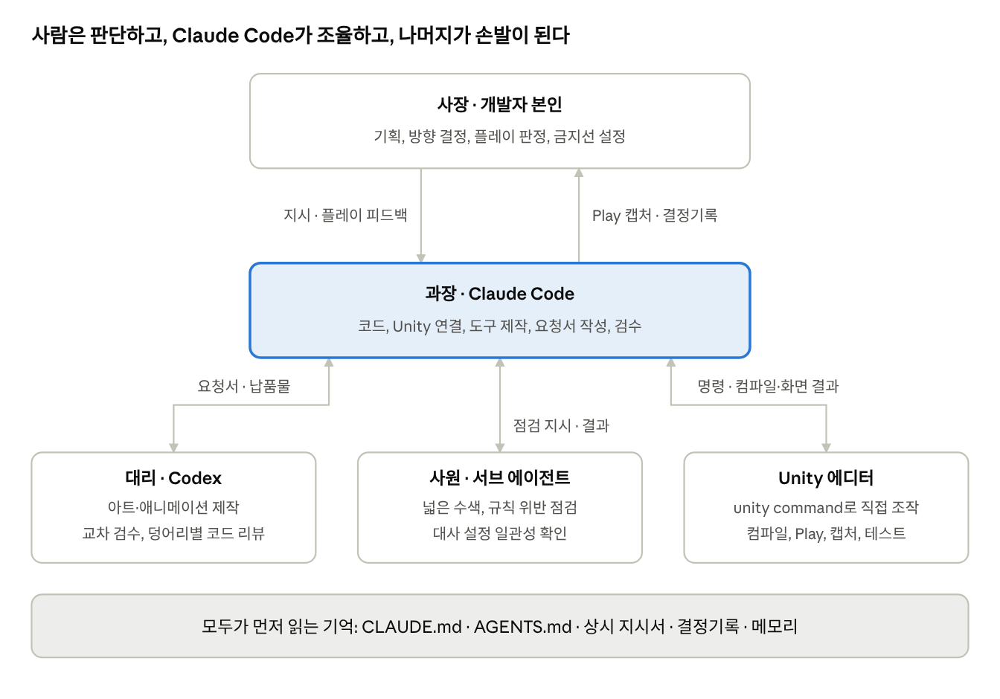
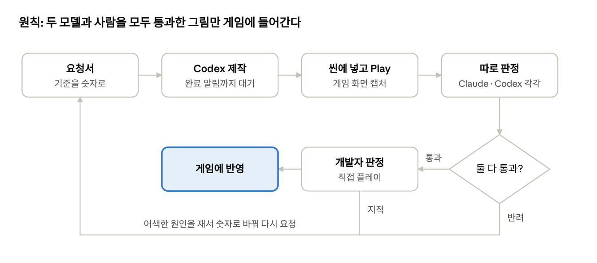

# 《지하거래소의 후원자》 바이브 코딩 활용 방식

Unity 게임 《지하거래소의 후원자》는 개발자가 기획과 판정을 맡고, Claude Code가 코드를, Codex가 아트를 맡아 만들었다

- 웹 데모: [itch.io에서 플레이](https://zjavm8702.itch.io/underwritedemo2026)

## 바이브 코딩 방식

핵심은 프롬프트를 잘 쓰는 것이 아니라 AI가 일하는 조직을 설계한 것이다. 역할, 문서, 도구, 권한을 먼저 정하고, 사람은 방향과 최종 판정에 집중했다.

*역할 구조 · CLAUDE.md, AGENTS.md, Documents/README.md 기준*

역할은 능력 차이로 나눴다. Codex에는 이미지 생성 도구가 있고 Claude Code에는 없어서 아트는 Codex가, 코드와 연결은 Claude Code가 맡았다.

### 1. 문서를 AI의 기억으로 삼았다

세션이 바뀌면 AI는 맥락을 잃는다. 그래서 판단 기준을 대화가 아니라 파일에 뒀다.

| 파일 | 읽는 쪽 | 하는 일 |
| --- | --- | --- |
| `CLAUDE.md` | Claude Code | 역할, 문서 위치, 운영상 함정, 검수 자세 |
| `AGENTS.md` | Codex | 아트 작업의 완료 범위 |
| `Tools/codex-art-brief.md` | Codex | 화풍·규격 제약과 보고 양식. 요청마다 자동으로 붙음 |
| `Underwrite_코드_작업규칙.md` | Claude Code | C# 규칙 v1.0. 서식은 `.editorconfig`가 강제 |
| `Underwrite_사장님_인터뷰_2026-10-18.md` | Claude Code | 개발자가 없을 때의 판단 기준 |
| `Underwrite_과장_결정기록.md` | 개발자 | AI가 혼자 정한 것의 기록 |

`Documents/`는 관리 주체별로 `Shared`·`Claude`·`Codex`로 나눴다. 문서끼리 어긋날 때의 우선순위도 `Documents/README.md`에 적었다.

### 2. AI에게 인터뷰를 받아 재량을 정했다

10/18에 Claude Code가 개발자에게 7차에 걸쳐 질문했고, 그 답을 혼자 일할 때의 기준으로 문서화했다. 원칙은 「멈춰 있는 것이 크게 잘못 가는 것보다 나쁘다」였다.

- 혼자 정해도 되는 것: 기획의 미정 항목, 수치·밸런스, 대사 초안, 커밋
- 절대 혼자 하지 않는 것: 돈 쓰는 일, 외부 공개(`git push`, 스팀, SNS)
- 혼자 정한 것은 「정한 것 · 왜 · 되돌리려면」 형식으로 결정기록에 쌓는다

덕분에 개발자가 자리를 비워도 작업이 이어졌고, 돌아와서 결정기록만 읽고 뒤집을 수 있었다.

### 3. 위임을 도구로 고정했다

`Tools/codex-art.sh`가 상시 지시서를 요청 앞에 붙여 Codex를 호출한다. 기본은 읽기 전용이고, `-w`일 때만 파일을 쓰며, `-n`으로 보낼 프롬프트를 미리 본다. 요청서 40개는 `Tools/requests/`에 남아 있다.

요청은 말이 아니라 숫자로 썼다. 「덜 기울여라」는 또 어긋났고, 「원형 상판의 세로÷가로 0.45~0.55」는 맞았다.

### 4. AI가 에디터를 직접 돌리게 했다

`com.unity.pipeline` 패키지의 `unity command`로 Claude Code가 실행 중인 에디터를 다뤘다. 컴파일 오류 확인, Play, 화면 캡처, 테스트 실행을 사람을 거치지 않고 직접 한다. 이 덕분에 「고치고, 돌려 보고, 캡처로 확인」까지가 AI 쪽에서 닫혔다.

### 5. 사람의 플레이가 방향을 잡았다

개발자가 직접 플레이하고 번호를 붙여 피드백을 주면, 표로 받아 처리했다. 10/17 하루에만 세 차례 돌았다. 「10주만 사도 가격이 튄다」, 「바로 주식 창이 열려 뜬금없다」 같은 지적은 AI가 스스로 찾기 어려운 종류였다.

### 6. 사용량을 자원으로 관리했다

Codex 사용량은 아트와 리뷰가 나눠 쓴다. 그래서 동시에 한 건만 걸고, 코드 리뷰는 기능 덩어리당 한 번만 했다. 일러스트가 아닌 그림은 무료 상업용 에셋부터 찾았고, 사용량이 바닥나면 코드 일로 돌렸다.

## AI 결과물 품질 관리

AI의 보고는 그대로 믿지 않았다. 측정값, 실제 게임 화면, 다른 모델의 판정, 사람의 플레이로 한 번 더 확인했다.

*아트 검수 흐름 · 개발자 인터뷰 §5, 결정기록 기준*

### 아트: 수치가 아니라 게임 화면으로 판정

영지 배경 v2는 시점·면적·연결 수치를 모두 통과했지만 화면에서 캐릭터와 따로 놀았다. 그 뒤로 씬에 넣고 Play 캡처를 본 뒤에만 합격시켰다. Claude와 Codex가 각자 따로 판정해 비교했다.

| 대상 | Claude 판정 | Codex 판정 | 결과 |
| --- | --- | --- | --- |
| 지하 방 v1 | 판석이 크고 휑함, 끊긴 기둥 | 슬롭 「예」, 바닥·기둥·계단 반려 | 들이지 않음 |
| 지하 방 v2 | 피로 읽히는 얼룩, 가운데 뜬 기둥 | 「데모에 넣으면 안 됨」 | 들이지 않고 배치를 새로 짰 |
| 거래 화면 키트 v1 | 틀은 좋으나 매수·매도 단추가 평평함 | 슬롭 잔존, 부분 통과 | 그림 재요청 없이 배치·USS로 수정 |
| 영지 전체 | 가장 나음 | 슬롭 쪽 | 의견이 갈려 개발자가 Play 화면으로 판단 |
| 주민 초상 v3 | 통과 | 통과 | 반영 |

지하 방 v3는 Codex 사용량이 바닥나 Claude 혼자 부분 통과로 임시 반영했는데, 개발자가 플레이하고 「바닥, 계단, 벽의 사물」을 지적해 v4로 이어졌다. 마지막 관문은 사람이었다.

### 코드: 다른 모델의 리뷰

같은 모델의 서브 에이전트는 맹점을 공유한다. 그래서 넓은 수색은 서브 에이전트에, 기능 덩어리의 최종 리뷰는 Codex에 맡겼다.

자동 테스트는 24개다. 계절 달력, 계절 흐름, 미니게임 판정을 다루며, 판정 로직을 바꾸면 돌리는 것을 규칙으로 두었다.

### 사람만 할 수 있는 판정

음성이 좋은 사례다. Claude는 소리를 들을 수 없어서, 음성 154개를 faster-whisper로 받아 적어 대사와 비교했다. 불일치 7개는 이렇게 잡았다. 그러나 기계음은 개발자의 귀로만 드러났고, 음성은 폐기했다.
