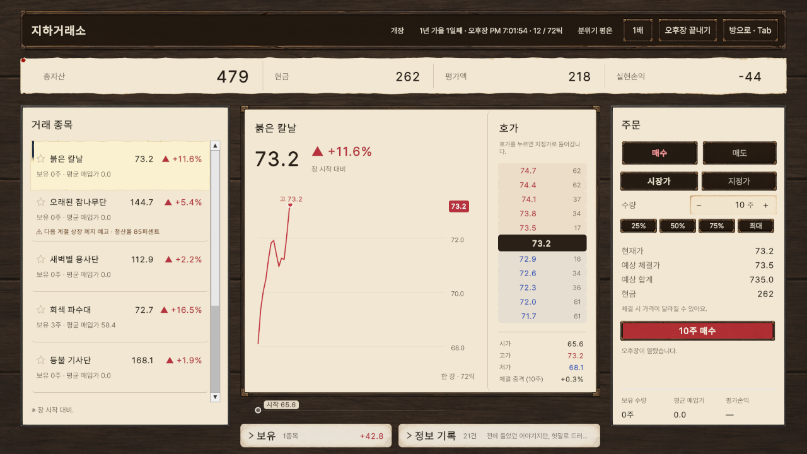
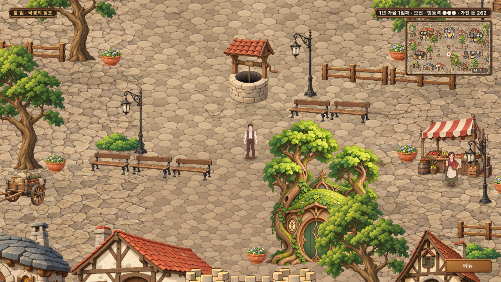
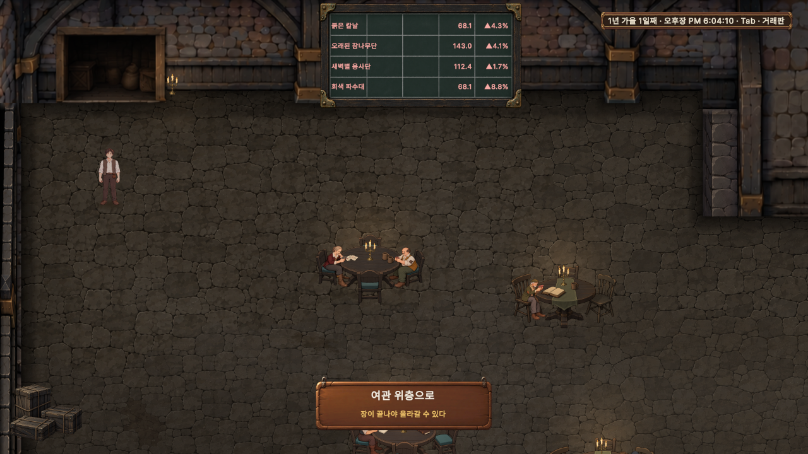

# 지하거래소의 후원자 (Underwrite)

판타지 세계의 모험가를 주식처럼 거래해 번 돈으로, 용사단을 익명으로 후원하는 2D 탑다운 게임입니다.

**[웹 데모 플레이 (itch.io)](https://zjavm8702.itch.io/underwritedemo2026)** · [AI 활용 방식](Documents/Claude/Underwrite_바이브코딩_활용방식.md)



| 영지 | 지하거래소 |
| --- | --- |
|  |  |

## 게임 소개

원작 게임에 빙의한 개인 투자자가 지하시장에서 돈을 벌어, 10년 뒤의 멸망을 막을 용사단을 뒤에서 돕습니다.

> 세계를 구할 힘은 없지만, 그 힘을 가진 사람에게 투자할 수 있다.

- **거래:** 실시간 시세와 호가창을 보고 용병단 종목을 사고팝니다.
- **정보 수집:** 영지를 돌아다니며 미니게임과 대화로 소문의 진위를 가려냅니다.
- **후원:** 번 돈으로 용사단의 사정을 익명으로 해결합니다. 놓치면 인물을 잃을 수 있습니다.

데모는 첫 두 계절까지입니다.

## 기술 스택

Unity 6.5 (6000.5.10f1) · C# · URP 2D · UI Toolkit · Input System · Cinemachine · DOTween · WebGL

## 구현 내용

| 영역 | 내용 | 코드 |
| --- | --- | --- |
| 시장 시뮬레이션 | 틱 기반 시세, 호가를 소진하며 체결되는 주문, 실제 시장 자료로 보정한 가격 모델 | [`OrderBook`](Assets/Scripts/Market/OrderBook.cs), [`PriceModel`](Assets/Scripts/Market/PriceModel.cs), [`MarketSimulation`](Assets/Scripts/Market/MarketSimulation.cs) |
| 영지 | 충돌체를 읽어 만든 격자 길찾기, NPC 이동 | [`VillageNavGrid`](Assets/Scripts/Village/VillageNavGrid.cs) |
| 저장 | 저장·이어하기, 옛 저장 데이터 보정 | [`SaveSystem`](Assets/Scripts/Save/SaveSystem.cs) |
| 애니메이션 도구 | 방향별 PNG에서 8방향 Sprite Library와 클립을 자동 생성 | [`DirectionalAnimationBuilder`](Assets/Editor/Animation/DirectionalAnimationBuilder.cs) |
| 데이터 도구 | 표 데이터를 게임 에셋으로 가져오기 | [`TableImporter`](Assets/Editor/Data/TableImporter.cs) |
| 웹 빌드 | 웹 빌드에만 그림을 압축해 데이터를 1.1GB에서 192MB로 축소 | [`WebDemoBuild`](Assets/Editor/Utility/WebDemoBuild.cs) |

## 프로젝트 구조

```text
Assets/Scripts/   런타임 코드 (Market, Village, UI, Story, Save 등)
Assets/Editor/    에디터 도구와 테스트
Documents/        기획, 코드·아트 규칙, 설계 문서
Tools/            Codex 위임 스크립트와 요청서
```

코드 규칙은 [코드 작업 규칙](Documents/Claude/Underwrite_코드_작업규칙.md)에 있습니다.

## AI 활용

이 프로젝트는 AI와 함께 만들었습니다. 개발자가 기획과 판정을 맡고, Claude Code가 코드를, Codex가 아트를 맡았습니다. 역할 구조와 검수 방식은 [바이브 코딩 활용 방식](Documents/Claude/Underwrite_바이브코딩_활용방식.md)에 정리했습니다.

## 실행 방법

1. Unity 6000.5.10f1로 프로젝트를 엽니다.
2. `Assets/Scenes/Intro.unity`를 열고 Play를 누릅니다.

테스트는 Unity Test Runner의 Edit Mode에서 실행합니다(`Assets/Editor/Tests`).

## 외부 자산

- [DOTween](http://dotween.demigiant.com/) (Demigiant)
- 글꼴: Pretendard, Noto Serif KR
- 음악·효과음: CC0 에셋. 출처는 [에셋 출처](Documents/Claude/Underwrite_에셋_출처.md)에 있습니다.
